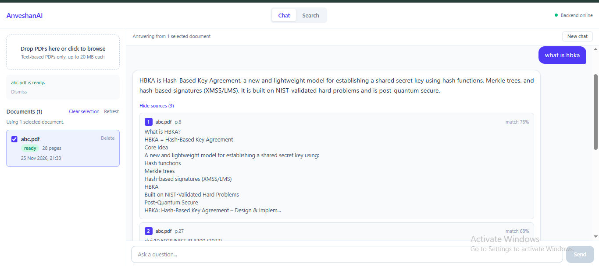
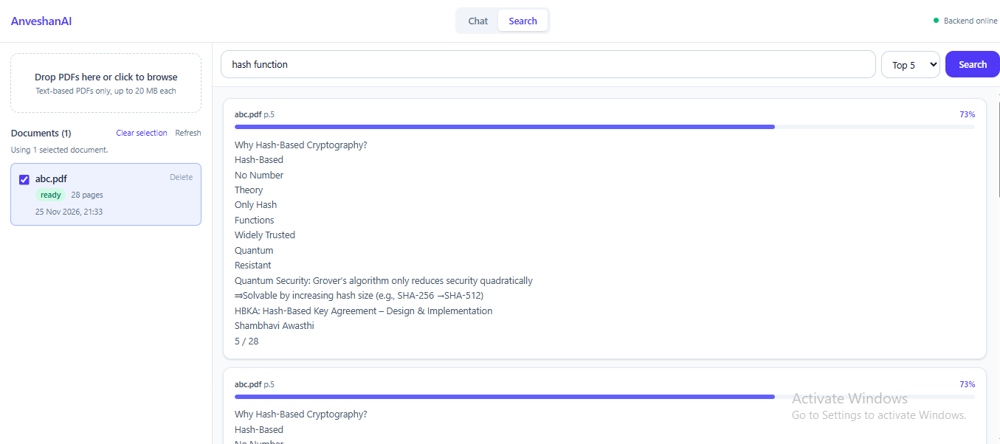
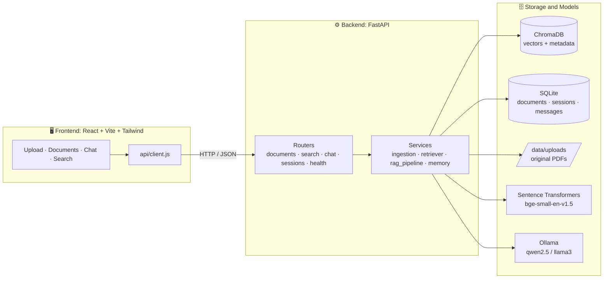
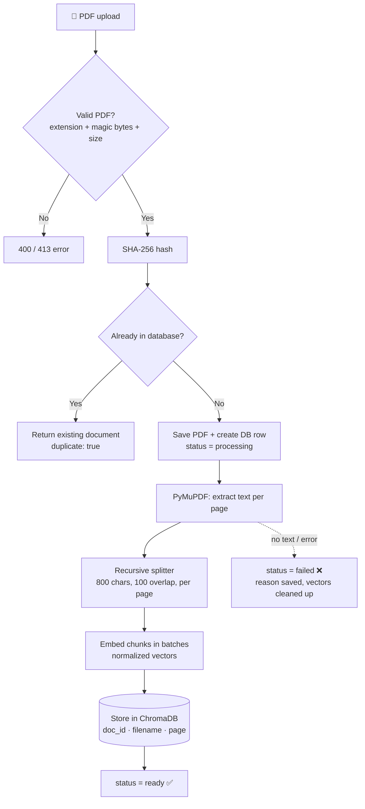
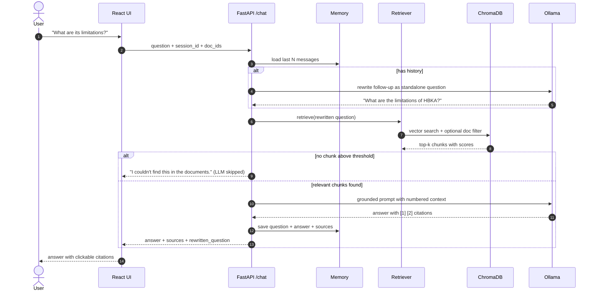

<div align="center">

# 🔍 AnveshanAI

### A local-first AI knowledge assistant: upload PDFs, search by meaning, and get answers with source citations.

*Anveshan (अन्वेषण) means "exploration" or "investigation" in Sanskrit.*


**100% local** · **No API keys** · **No data leaves your machine**

[Features](#-features) · [Architecture](#-architecture) · [Tech Stack](#-tech-stack) · [Getting Started](#-getting-started) · [API](#-api-reference) · [Design Decisions](#-design-decisions) · [Roadmap](#-roadmap)

</div>

---

## 📖 Overview

**AnveshanAI** is a Retrieval-Augmented Generation (RAG) application. You upload PDF documents, and then ask questions in plain language. The system finds the most relevant passages by *meaning* (not keyword matching), feeds them to a local LLM, and returns a grounded answer along with the **exact file and page** each claim came from.

Everything runs on your own machine: embeddings are computed locally, vectors live in a local database, and the language model runs through [Ollama](https://ollama.com). There are no paid APIs and no cloud dependencies.

<!--
Add screenshots once you have them, then uncomment this block.

## 📸 Screenshots

| Chat with citations | Semantic search |
|---|---|
|  |  |
-->

---

## ✨ Features

| # | Feature | What it does |
|---|---|---|
| 1 | **📄 Document Upload** | Upload PDFs (drag and drop, multiple files). Text is extracted page by page. Duplicate files are detected by SHA-256 hash and skipped. |
| 2 | **🧬 Embeddings + Vector DB** | Pages are split into overlapping chunks, converted to embeddings with `BAAI/bge-small-en-v1.5`, and stored in ChromaDB with page metadata. |
| 3 | **🔎 Semantic Search** | Finds passages by meaning, with similarity scores. Can be limited to specific documents. |
| 4 | **💬 RAG Chatbot** | Answers *only* from retrieved context, with clickable `[1]`, `[2]` citations pointing to file, page and snippet. Says "I couldn't find this in the documents" instead of guessing. |
| 5 | **🧠 Conversation Memory** | Remembers previous turns. Follow-ups like *"What are its limitations?"* are rewritten into standalone questions before retrieval. |

### Extras

- 🛡️ **Anti-hallucination guard**: a similarity threshold stops irrelevant questions before the LLM is even called
- 🎯 **Document scoping**: tick specific documents to restrict both search and chat to them
- 💾 **Persistent sessions**: conversations (with their sources) survive page refreshes and server restarts
- ⏱️ **Patient UI**: live elapsed timer while a local model is generating
- 🧪 **28 automated tests** that run in seconds, with no Ollama and no model downloads needed

---

## 🏗️ Architecture

### System overview



The backend is layered so each piece can be tested and swapped on its own:

```
Routers (HTTP only)  →  Services (business logic)  →  Stores (Chroma / SQLite / Ollama)
```

### Ingestion pipeline: what happens on upload



### Question answering: what happens on every chat message



---

## 🧰 Tech Stack

| Layer | Technology | Why |
|---|---|---|
| **Web framework** | FastAPI + Uvicorn | Async-ready, automatic OpenAPI docs, strict Pydantic validation |
| **Vector database** | ChromaDB (behind a `VectorStore` interface) | Free, local, persistent, native metadata filtering, swappable later |
| **Embeddings** | Sentence Transformers: `BAAI/bge-small-en-v1.5` | Fast on CPU, strong retrieval quality, zero API cost |
| **LLM runtime** | Ollama (`qwen2.5:3b` by default) | Free local inference with a clean HTTP API |
| **RAG orchestration** | Custom lightweight pipeline | Full control over grounding, citations and error handling |
| **PDF + chunking** | PyMuPDF + `langchain-text-splitters` | Fast page-level extraction that preserves page metadata |
| **Metadata + memory** | SQLite + SQLAlchemy | Dedup hashes, document status, chat sessions and messages |
| **Conversation memory** | Sliding window + query rewriting | Accurate follow-ups with bounded context size |
| **Config + HTTP** | `pydantic-settings`, `httpx` | Typed `.env` config and clean Ollama calls |
| **Testing** | `pytest` with fake LLM, embedder and vector store | 28 fast, deterministic tests |
| **Frontend** | React 19, Vite, Tailwind CSS v4 | Fast dev loop, utility-first styling |

---

## 📁 Project Structure

```
AnveshanAI/
├── backend/
│   ├── app/
│   │   ├── main.py                  # app, CORS, routers, startup (loads models once)
│   │   ├── core/
│   │   │   ├── config.py            # pydantic-settings
│   │   │   ├── logging.py
│   │   │   └── exceptions.py        # PDFError, LLMError
│   │   ├── db/
│   │   │   ├── database.py          # engine, session, Base
│   │   │   ├── models.py            # Document, ChatSession, Message
│   │   │   └── crud.py              # database functions
│   │   ├── schemas/                 # Pydantic request/response models
│   │   ├── api/routes/              # documents, search, chat, sessions, health
│   │   ├── services/
│   │   │   ├── pdf_loader.py        # PyMuPDF page extraction
│   │   │   ├── chunker.py           # page-aware chunking
│   │   │   ├── embedder.py          # Sentence Transformers (loaded once)
│   │   │   ├── vector_store.py      # VectorStore interface + ChromaVectorStore
│   │   │   ├── retriever.py         # embed query, search, apply threshold
│   │   │   ├── prompt_builder.py    # grounded prompt with numbered context
│   │   │   ├── llm.py               # Ollama client
│   │   │   ├── memory.py            # sliding window + query rewriting
│   │   │   ├── rag_pipeline.py      # question → answer orchestration
│   │   │   └── ingestion.py         # upload → extract → chunk → embed → store
│   │   └── utils/                   # file hashing, text cleaning
│   ├── data/                        # runtime data (git-ignored): uploads, chroma, app.db
│   ├── tests/                       # 28 tests with mocked services
│   ├── eval/                        # optional evaluation scripts
│   ├── .env.example
│   └── requirements.txt
│
├── frontend/
│   └── src/
│       ├── api/client.js            # every backend endpoint in one file
│       ├── hooks/                   # useDocuments, useChat, useHealth
│       ├── components/              # Upload, DocumentList, Chat, Search, Sources...
│       └── App.jsx
│
└── README.md
```

---

## 🚀 Getting Started

### Prerequisites

- **Python 3.10+** (3.11 or 3.12 is the safest choice for ML packages)
- **Node.js 20.19+**
- **[Ollama](https://ollama.com/download)** installed and running
- About **4 GB of free RAM** for a 3B model

### 1. Clone

```bash
git clone https://github.com/<your-username>/AnveshanAI.git
cd AnveshanAI
```

### 2. Pull a local model

```bash
ollama pull qwen2.5:3b
ollama list          # confirm it is installed
```

### 3. Backend

```powershell
cd backend
python -m venv .venv

# Windows (PowerShell)
.venv\Scripts\Activate.ps1
# macOS / Linux
# source .venv/bin/activate

pip install -r requirements.txt
copy .env.example .env        # macOS / Linux: cp .env.example .env

uvicorn app.main:app --reload
```

The first start downloads the embedding model (about 130 MB). After that, startup is fast.

- API: `http://127.0.0.1:8000`
- Interactive docs: `http://127.0.0.1:8000/docs`

### 4. Frontend

```bash
cd frontend
npm install
cp .env.example .env          # Windows: copy .env.example .env
npm run dev
```

Open **`http://localhost:5173`**.

> ⚠️ Use `localhost`, not `127.0.0.1`. The backend's CORS setting allows `http://localhost:5173`, so the other address will be blocked.

### 5. Try it

1. Drop a text-based PDF into the sidebar and wait for the green **ready** badge
2. Ask a question about it and click the `[1]` citation markers to see the sources
3. Ask a follow-up using "it" or "its" and watch the *"Searched for: ..."* line show the rewritten question
4. Open the **Search** tab to see raw semantic matches with similarity scores

---

## ⚙️ Configuration

All settings live in `backend/.env`:

| Variable | Default | Description |
|---|---|---|
| `OLLAMA_URL` | `http://localhost:11434` | Where Ollama is listening |
| `LLM_MODEL` | `qwen2.5:3b` | Any model you have pulled with Ollama |
| `EMBED_MODEL` | `BAAI/bge-small-en-v1.5` | Sentence Transformers model |
| `CHUNK_SIZE` | `800` | Characters per chunk |
| `CHUNK_OVERLAP` | `100` | Overlap between neighbouring chunks |
| `TOP_K` | `5` | Chunks sent to the LLM (`3` is faster on CPU) |
| `SCORE_THRESHOLD` | `0.35` | Minimum similarity to answer at all (`0.55` works well for bge-small) |
| `MAX_HISTORY` | `6` | Messages kept in the sliding memory window |
| `MAX_UPLOAD_MB` | `20` | Upload size limit |
| `FRONTEND_ORIGIN` | `http://localhost:5173` | Allowed CORS origin |

> 💡 **Tune `SCORE_THRESHOLD` for your documents.** Run a few answerable and unanswerable questions through the `/search` endpoint, note the top scores of each group, and set the threshold between them. It is the main guard against hallucinated answers.

> After editing `.env`, **restart uvicorn**. Settings are cached and `--reload` only watches `.py` files.

---

## 📡 API Reference

Interactive documentation is available at `/docs` when the backend is running.

| Method | Endpoint | Request | Response |
|---|---|---|---|
| `GET` | `/health` | none | `{status, app, llm_model, embed_model}` |
| `POST` | `/documents` | multipart `file` | `{id, filename, status, duplicate}` |
| `GET` | `/documents` | none | `[{id, filename, status, pages, created_at, error}]` |
| `DELETE` | `/documents/{id}` | none | `{deleted: true}` |
| `POST` | `/search` | `{query, top_k, doc_ids?}` | `[{text, score, filename, page, doc_id}]` |
| `POST` | `/sessions` | none | `{session_id}` |
| `GET` | `/sessions/{id}/messages` | none | `[{role, content, sources?}]` |
| `POST` | `/chat` | `{question, session_id?, doc_ids?}` | `{answer, sources[], rewritten_question}` |

<details>
<summary><b>Example: chat request and response</b></summary>

```http
POST /chat
Content-Type: application/json

{
  "session_id": "3f9a1c...",
  "question": "What are its limitations?"
}
```

```json
{
  "answer": "HBKA relies on stateful signature schemes, which require careful key management [1].",
  "sources": [
    {
      "id": 1,
      "filename": "research-paper.pdf",
      "page": 7,
      "snippet": "A key limitation of the approach is...",
      "score": 0.7412
    }
  ],
  "rewritten_question": "What are the limitations of HBKA?"
}
```

</details>

**Error responses** use the shape `{"detail": "..."}`:

| Status | Meaning |
|---|---|
| `400` | Bad input (not a PDF, blank question) |
| `404` | Unknown document or session id |
| `413` | File too large |
| `422` | Validation error |
| `503` | Ollama is down, slow, or the model is missing |

---

## 🧠 Design Decisions

| Decision | Reasoning |
|---|---|
| **Chunk per page, not per document** | Every chunk keeps its page number, which is what makes accurate citations possible. |
| **Query prefix on BGE queries only** | BGE models are trained to expect an instruction prefix on *queries* and none on *documents*. Mixing this up quietly hurts retrieval. |
| **Normalized embeddings + cosine distance** | Similarity becomes a simple 0 to 1 score the UI can display and the threshold can compare against. |
| **Score threshold before the LLM** | If nothing relevant is retrieved, the LLM is never called, which saves seconds of CPU time and removes the chance of a made-up answer. |
| **"Not found" answers carry no sources** | A refusal with citations attached would be contradictory, so sources are dropped when the model declines. |
| **Query rewriting for follow-ups** | Retrieval needs a self-contained question. The rewrite is skipped on the first turn, so it only costs an extra LLM call when it helps. |
| **Failed exchanges are not saved** | If Ollama errors out, the question is not stored, so the user can retry without polluting the history. |
| **SHA-256 deduplication** | The same file uploaded twice is indexed once, even under a different filename. |
| **Models loaded once at startup** | Loading the embedding model per request would add seconds to every call. |
| **`VectorStore` interface** | Chroma is hidden behind `add_chunks`, `search` and `delete_by_doc`, so another vector database can replace it without touching the pipeline. |
| **Synchronous upload** | The request returns once indexing finishes, so the UI shows a spinner and the status is already final. No polling needed. |
| **Single API client on the frontend** | Every endpoint lives in `api/client.js`, so a backend change touches one file. |

---

## 🧪 Testing

```bash
cd backend
pytest -v
```

The suite has **28 tests** and runs in a few seconds. The LLM, embedder and vector store are replaced with small fakes, and each test gets its own temporary SQLite file and uploads folder, so your real data is never touched and no model has to be downloaded.

Covered scenarios:

- PDF page extraction and page-aware chunking
- Upload, deduplication, fake-PDF rejection, scanned-PDF failure, delete
- Semantic ranking, document filtering and threshold behaviour
- The "not found" path (LLM is skipped), model refusals, and Ollama-down → `503`
- Follow-up rewriting, saved sources, sliding window, unknown sessions

---

## ⚠️ Limitations

- **Text-based PDFs only.** Scanned documents have no text layer, and OCR is out of scope. They are marked `failed` with a clear reason.
- **Speed depends on your hardware.** On CPU, a 3B model can take tens of seconds per answer. A GPU or a smaller model helps a lot.
- **Single user, no authentication.** Sessions are anonymous and stored locally.
- **Answer quality tracks model size.** Small local models can occasionally ignore instructions or cite a marker that does not exist (the UI ignores unmatched markers).
- **Non-streaming responses.** Answers appear all at once when generation finishes.

---

## 🗺️ Roadmap

- [ ] Streaming answers (`/chat/stream` with Server-Sent Events)
- [ ] Docker and `docker-compose` setup
- [ ] Hybrid search (BM25 + vectors) and a reranker
- [ ] OCR support for scanned PDFs
- [ ] Support for DOCX, TXT and Markdown
- [ ] RAGAS evaluation on a hand-made Q&A set (faithfulness, answer relevance)
- [ ] Swap in Azure OpenAI and a managed vector database through the existing interfaces
- [ ] Authentication and per-user document libraries

---

## 🤝 Contributing

Issues and pull requests are welcome. For larger changes, please open an issue first to discuss what you would like to change. Please run `pytest` before submitting a PR.

---

## 👩‍💻 Author

**Shambhavi Awasthi**
B.Tech Computer Science and Engineering

- GitHub: [@your-username](https://github.com/your-username)
- LinkedIn: [your-profile](https://linkedin.com/in/your-profile)

---

## 📄 License

This project is licensed under the MIT License. See the `LICENSE` file for details.

<div align="center">

⭐ **If you found this project useful, consider giving it a star.** ⭐

</div>
